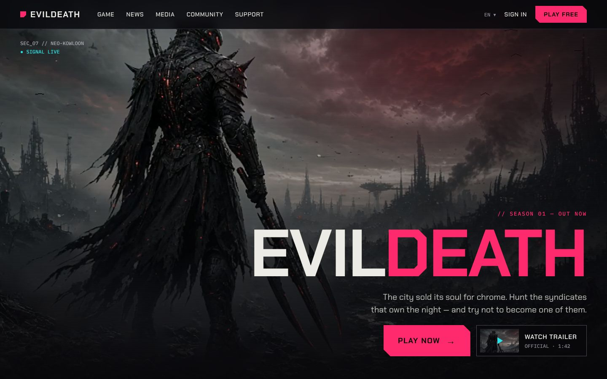
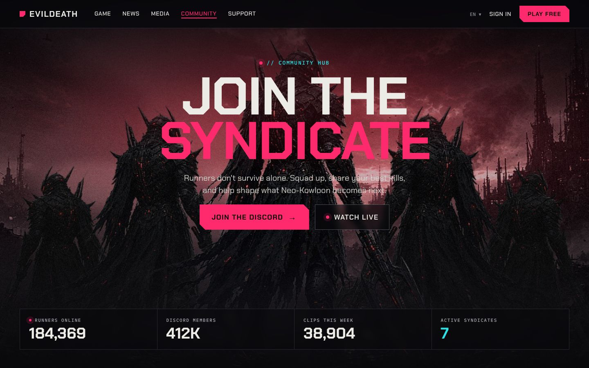
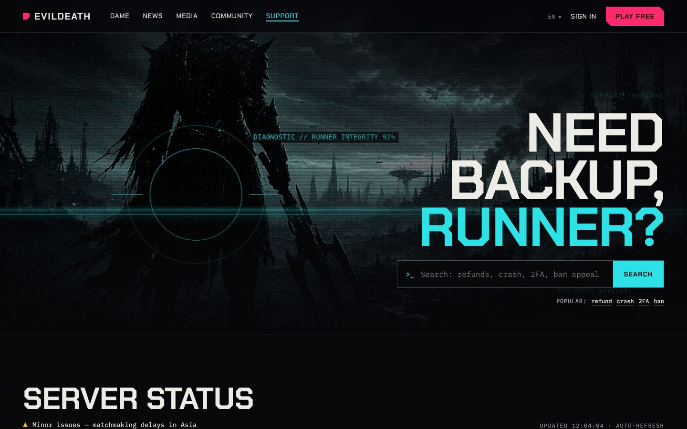
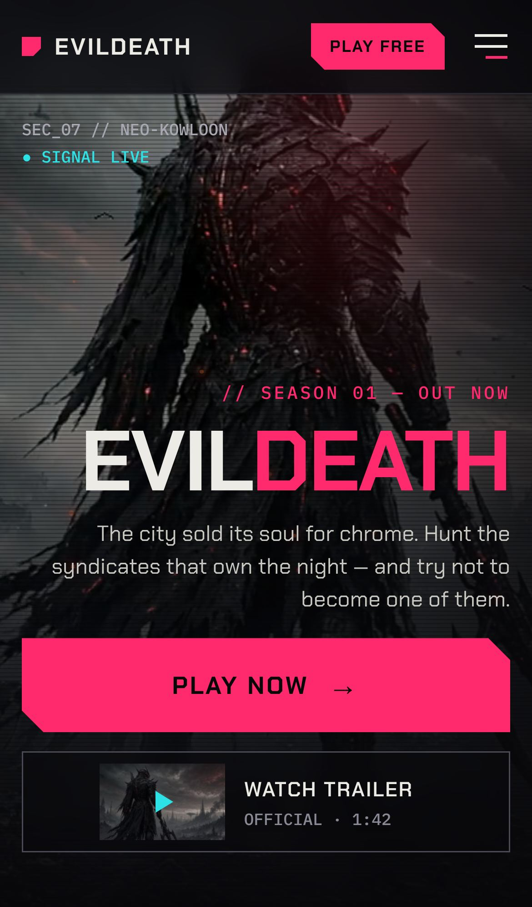
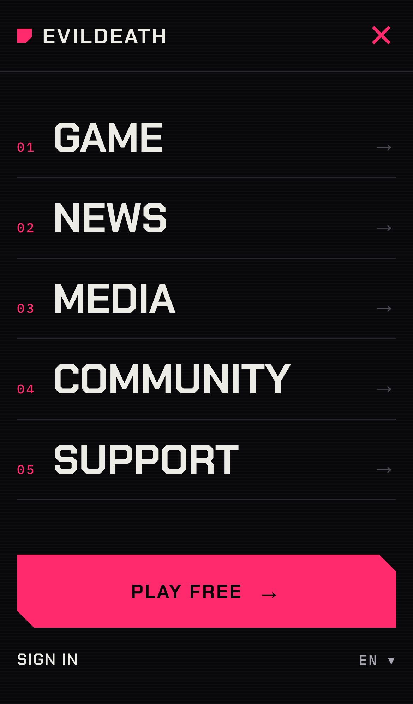

# EVILDEATH-Game

Official website for **EvilDeath**, a dark cyberpunk action game. Responsive landing, community and support pages with an animated hero, glitch effects, parallax scrolling, live server status, an event countdown and a support ticket form, built in plain HTML, CSS and JavaScript.



## Pages

| Page | File | Highlights |
| --- | --- | --- |
| Landing | `index.html` | Full-screen animated hero video, trailer modal, features, latest news, "Jack in" call to action |
| Community | `community.html` | Syndicate hero with live "runners online" counter, channel cards, event countdown with reminders, fan-art gallery with likes, season/weekly leaderboard, creator program |
| Support | `support.html` | Help search, live server status by region, topic filters, searchable FAQ accordion, known issues, validated ticket form |

<p>
  
  
</p>

## Features

- **Animated hero.** An 8-second looping video of the key art with a rippling cape, swaying trident, pulsing armor veins and lightning, plus CSS fog and rising embers on top.
- **Glitch text.** Headlines split into cyan and pink channels at random intervals, more intensely on hover. Small HUD labels flicker like a weak signal.
- **Parallax.** Hero layers move at different speeds and the copy fades on scroll. Card and section images drift inside their frames.
- **Fully responsive.** Below 900px the navigation collapses into a burger icon that opens a full-screen menu. Layouts reflow down to 320px with no horizontal scrolling.
- **Accessible motion.** Visitors with "reduce motion" turned on get a still hero and no glitch, flicker or parallax.

<p>
  
  
</p>

## Run locally

No build step. Serve the folder with any static server, for example:

```bash
python3 -m http.server 8000
# then open http://localhost:8000
```

Opening the HTML files directly from disk (`file://`) won't work, because the pages load their templates over HTTP.

## Deploy with GitHub Pages

1. Go to **Settings → Pages**.
2. Under **Build and deployment**, choose **Deploy from a branch**, select `main` and `/ (root)`, and save.
3. After a minute or two the site is live at `https://<your-username>.github.io/EVILDEATH-Game/`.

## Project structure

```
index.html            Landing page
community.html        Community page
support.html          Support page
support.js            Page runtime (renders the templates; loads React from unpkg)
image-slot.js         Image component used by feature, news and key-art images
hero-motion.mp4       Looping hero video
hero-motion-poster.jpg
img/                  Feature, news, key-art, community and support images
docs/screenshots/     README screenshots
```

Each page keeps its markup, styles and logic in one file. The logic lives in the `<script type="text/x-dc">` block at the bottom of each page. Fonts are Chakra Petch and IBM Plex Mono from Google Fonts.

## Placeholder content

Names, numbers, dates, handles, leaderboard entries, FAQ answers and server statuses are placeholders. Social and "Start chat" buttons link to sections on the page rather than real accounts. Replace them before launch.
